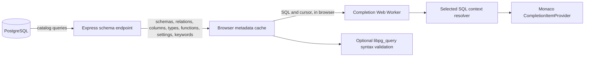

# CrabSense 🦀

A small, crab-themed PostgreSQL autocomplete demo. Monaco Editor suggests real database objects discovered from the running PostgreSQL instance.

The editor replaces Monaco's generic SQL keyword list with the connected PostgreSQL server's `pg_get_keywords()` list after `/api/schema` loads. This colors PostgreSQL words such as `SHOW`, `ILIKE`, and `LISTEN`. Highlighting is lexical and independent of completion and syntax validation; it does not indicate whether a statement is valid. Open **Inspect editor metadata** below the editor to inspect the full completion snapshot, the Monaco keyword input and reserved keyword count, and the selected method's result and mapped Monaco items at the cursor.

## Run

Requirements: Docker with Compose. From this directory:

```sh
docker compose up --build
```

Open [http://localhost:3000](http://localhost:3000). The first startup initializes the sample database. Stop with `Ctrl+C`, or use `docker compose down`. To erase the sample database and reseed it from scratch, run `docker compose down -v` before starting again. The Compose password is a local demo credential; change it before adapting this project beyond local use.

The seed has 20 user tables and views across `public` and `harbor`, including voyages, ports, cargo, crew, maintenance, and weather records. It also defines a cargo risk enum and positive weight domain. The renamed demo uses a fresh `pgdata_v3` Compose volume, leaving earlier local volumes intact. PostgreSQL initializes a volume only once; later edits to the seed do not change an existing database. The catalog API also includes accessible `information_schema` views and `pg_catalog` relations and types.

## Try autocomplete

Start typing in an empty editor to see statement suggestions, including `SELECT`, `INSERT`, `UPDATE`, `DELETE`, and `SHOW`. Typing identifier letters, a space, or a dot opens suggestions automatically. You can also press **Ctrl+Enter** (**⌘+Enter** on Mac), or click **Suggestions** above the editor. Monaco's **Ctrl+Space** shortcut may also work, but operating system shortcuts can intercept it. Suggestions use a live schema snapshot.

The **Example** selector above the editor offers a fleet join, chained CTEs, a CTE body start, correlated `EXISTS` subqueries, a derived table, a type declaration, `JOIN USING`, `UNION` ordering, draft DDL, and a table function. Choosing one replaces the editor text, moves the cursor to the feature being demonstrated, and opens suggestions. **New query** clears the editor. The object explorer shows demo objects by default; search includes system schemas and column names, and **Insert** adds an object name at the cursor. For example, `Start a CTE` offers `SELECT` after `AS (`, `JOIN USING` offers the shared `id` column, `UNION ORDER BY` offers the first branch's `display_name` alias, and `Draft table` offers the `note` column declared earlier in the editor. The draft table exists only in editor text; run its `CREATE TABLE` statement in a separate PostgreSQL client before trying to execute the whole example. The playground itself does not execute SQL.

Choose a **Completion method** to compare **CrabSense** against **CodeMirror SQL**, using [`@codemirror/lang-sql`](https://github.com/codemirror/lang-sql)'s published PostgreSQL keyword and schema completion sources. CodeMirror determines its own SQL context, aliases, and candidates. It never calls CrabSense's resolver, candidate generator, or ranking, including on malformed input.

Both receive the same catalog snapshot. CodeMirror's native namespace configuration receives schemas, relations, columns, and functions; its PostgreSQL dialect supplies its own keywords and types. Its API has no corresponding settings, draft-DDL, or overload configuration. Those differences remain visible.

Open **Compare completion methods** below the editor to see the first 60 suggestions from each method. Both the comparison and Monaco's popup are capped at 500 suggestions; a `500+` count means more matches exist. For CodeMirror, the adapter applies case-insensitive prefix filtering to upstream options and preserves source order. It uses upstream replacement ranges, including closing quotes. This compares native completion **sources**, not CodeMirror's full editor popup: native fuzzy matching and popup ranking are not reproduced, so top-result ranking is not scored. CodeMirror does not report a context category; the panel and reports say so explicitly. Errors are displayed as unavailable, without falling back to CrabSense.


## Architecture



The server queries `pg_catalog` for accessible user and system schemas, tables, views, materialized views, columns, types, user-defined functions, built-in routines, configuration names from `pg_settings`, and PostgreSQL keywords. It caches the result for 30 seconds. The browser sends the snapshot to a dedicated completion worker after loading or refresh, then sends editor SQL and cursor offsets to that worker for both comparison methods. The main thread maps results to Monaco items and discards canceled or stale replies. Signature help remains on the main thread. The editor does **not** execute SQL or send it to the server. Sample rows exist to make the PostgreSQL setup realistic, but no query runner is part of this prototype.

Key files: `src/sql-context.js` (shared lexer, query scopes, and cursor states), `src/completion.js` (catalog bindings and candidate generation), `src/ranking.js` (ranking and result caps), `demo/src/methods/` (independent CodeMirror adapter and syntax validation), `demo/src/completion.worker.js` and `demo/src/completion-worker-client.js` (worker protocol), `demo/src/monaco-completion.js` (Monaco ranking adapter), `demo/src/main.js` (Monaco and UI), `demo/server/index.js` (introspection API), `demo/db/init.sql` (seed schema and rows), `AGENTS.md` (Codex instructions).

Cursor states distinguish an operand from a continuation and an alias name from a completed alias. The package resolver supplies those states to candidate generation; the Monaco adapter receives the final ordered list. `demo/tests/context-correctness.test.js` independently checks PostgreSQL grammar with `libpg_query` for 21 completed expression forms and expansions of each offered continuation. These checks cover syntax, not catalog existence or SQL type compatibility.


`demo/tests/codemirror.test.js` checks the adapter against direct upstream calls, including aliases, quoted identifiers, malformed SQL, comments, and nested queries. `demo/public/libpg-query.wasm` comes from `libpg-query` 17.7.4; its MIT license is in `demo/public/LICENSE-libpg-query`.

## Validate

```sh
npm test
npm run demo:test
docker compose config --quiet
docker compose up --build -d
curl -fsS http://localhost:3000/health
curl -fsS http://localhost:3000/api/schema
```

The API response should include `public.sailors`, `public.vessels`, `public.active_fleet`, `harbor.voyages`, and `harbor.port_label`. Open the browser and try the cursor examples above. `npm run demo:build` checks the frontend if Node dependencies are installed locally.

Run `npm --prefix demo run compare:methods` for a reproducible differential fuzz and latency benchmark. It warms each method, then measures 12 baseline cursors and 200 deterministic SQL mutations. To use a live catalog snapshot, save `GET /api/schema` to a JSON file and run `node demo/scripts/compare-methods.mjs path/to/schema.json`. The report shows failures, latency percentiles, and agreement with CrabSense on suggestion labels. Agreement is not a correctness score; the methods have different intended scope and recovery behavior.

Run `npm run benchmark:package` to measure CrabSense on a short query and scripts with 100 or 1,000 earlier statements, including 1,000 draft `CREATE TABLE` statements. Pass a saved schema JSON path to use live catalog sizes: `npm run benchmark:package -- path/to/schema.json`. These warmed Node timings exclude Monaco rendering, WASM startup, and network requests.

Run `npm --prefix demo run benchmark:schema-scale` to compare prepared CrabSense and CodeMirror completion sources with 100, 1,000, and 10,000 relations, each with ten columns. Add `-- --large` for 50,000 relations. Candidate counts and expected table/column presence are reported. These warmed Node timings include source invocation and adapter conversion, exclude metadata preparation, Monaco rendering, and network time, and reuse identical SQL within each workload. CodeMirror keeps its native parse state; CrabSense keeps its catalog indexes. These are not full editor typing latency measurements.

Run `npm --prefix demo run measure:correctness` for 86 curated scenarios checking candidates and replacement offsets. Context labels and top-result ranking are **n/a** for CodeMirror, whose source API does not provide them. Cases were developed around CrabSense behaviors, including draft DDL and PostgreSQL settings; the aggregate reports coverage of this fixture, not a general library ranking. Individual misses are listed. `npm run demo:test` gates CrabSense expectations and independent adapter tests; it does not require a competitor to mimic CrabSense.

## Large single-query stress tests

Run `npm --prefix demo run benchmark:query-stress` for 27 deterministic single-statement fixtures. Add `-- --large` for 150 CTEs, 150 joins, nesting depth 128 (129 for the correlated-alias fixture), and 5,000 projection expressions (about 329 KB). The default sizes, including 50 CTEs, depth 40, and 1,500 projections, run as correctness regressions in `npm run demo:test`.

Families cover chained CTEs, joins, CTE + LATERAL + window + UNION queries, deeply shadowed aliases, correlated outer aliases, incomplete JOIN identifiers, unfinished nested queries, and wide projections containing dollar-quoted SQL punctuation. Each fixture specifies required/forbidden candidates and exact replacement ranges. Completed scaffolds are syntax-checked with libpg_query, never executed; this does not verify semantic typing or database execution.

The benchmark reports first-call latency, unchanged-query p50/p95, and p50/p95 after alternating one-letter prefix edits. It caps both providers at 500 results and takes 15 samples per mode. Setup, Monaco rendering and network time are excluded. CodeMirror's adapter currently replaces its whole document on edits, so edit timings include full replacement rather than an optimized incremental editor transaction. CodeMirror's native popup matching/ranking is not measured. A faster result with missing required candidates is marked incorrect.

Save machine-readable results with `-- --large --json /tmp/query-stress.json`. Add `--assert-crabsense` to fail the benchmark on a CrabSense candidate/range failure. Timing has no machine-dependent pass threshold. See [the measured stress results](../demo/benchmarks/query-stress.md).

## Prototype limits

CrabSense handles common SELECT, INSERT, UPDATE, DELETE, TRUNCATE, and SHOW contexts. It remains a heuristic engine: complex recursive CTE types, arbitrary expression types, procedural SQL, temporary schemas, exact routine overload rules, and every PostgreSQL scope rule are not modeled. CodeMirror has its own behavior and limitations; the adapter does not fill missing features with CrabSense. The validator checks syntax only and never runs queries.
